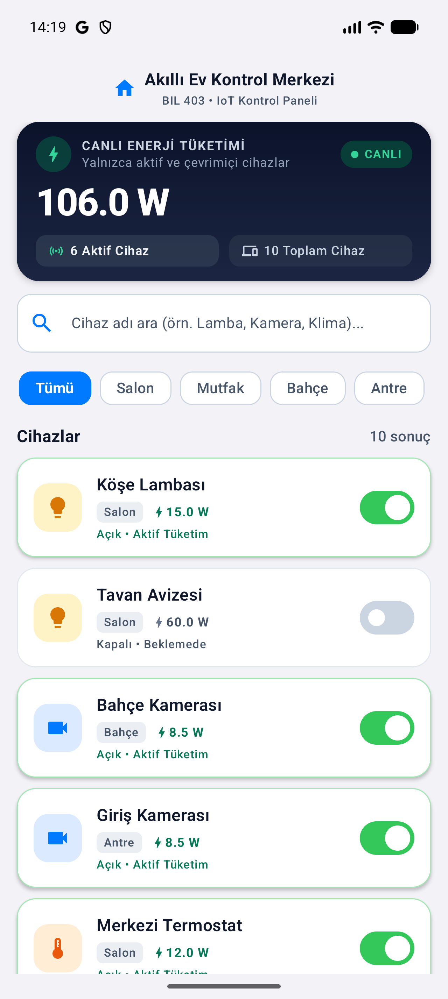
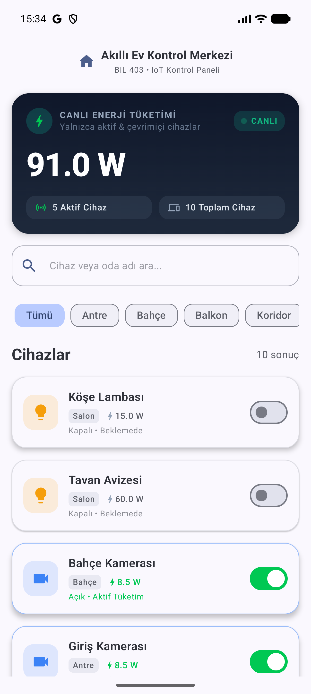
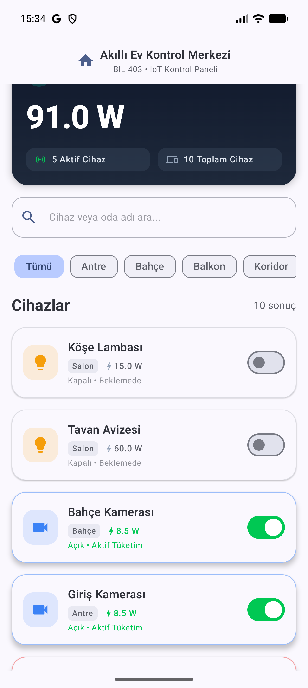
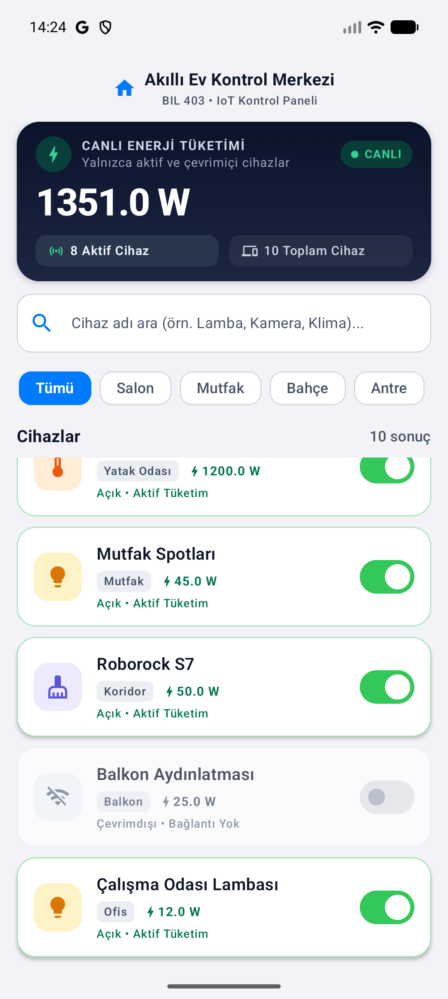
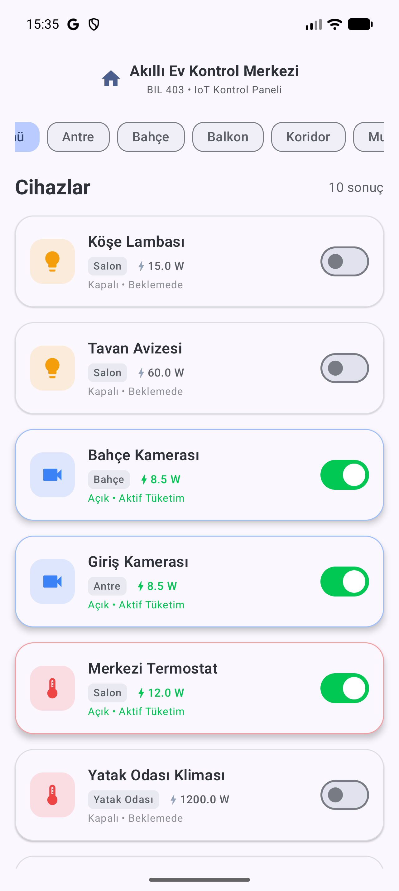
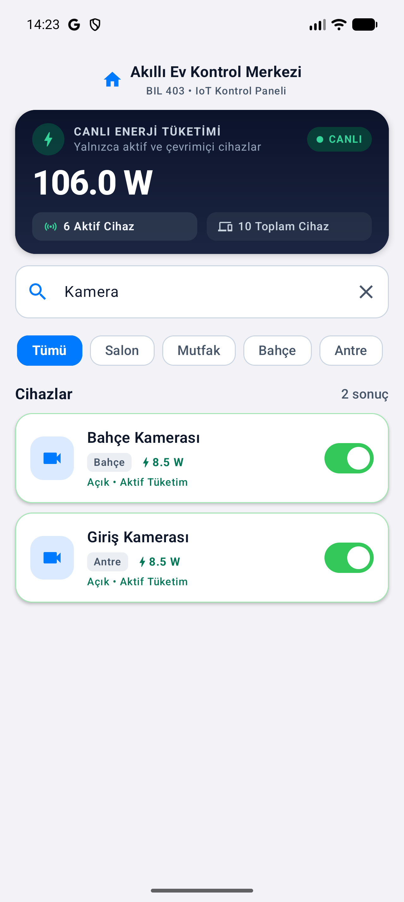

# week3_assignment - Akıllı Ev (IoT) Kontrol Merkezi

**BIL 403 - Mobil Uygulama Geliştirme**  
**Hafta 3 Ödevi: Kurumsal MVVM, Jetpack Compose, Coroutines ve StateFlow Mimarisi**

---

## 📌 Proje Genel Bakış ve Konsept

Bu proje, evdeki akıllı cihazların durumunu (açık/kapalı), odalarını (Salon, Mutfak, Bahçe...) ve anlık elektrik tüketimlerini (Watt) reaktif ve asenkron olarak yöneten bir **"Akıllı Ev (IoT) Kontrol Merkezi"** uygulamasıdır.

Tüm isterler ve kurallar ders mimari standartlarına **%100 uygun** olarak geliştirilmiş; arayüz tasarımı ise **Apple Human Interface Guidelines (HIG)** erişilebilirlik (WCAG AA 4.5:1+ kontrast) ve görsel hiyerarşi prensiplerine göre kurgulanmıştır.

---

## 🏛️ Mimari Kurallar ve Uygulama Prensipleri

### 1. Kural 1 (Katman Ayrımı): %100 Stateless Compose UI
* **Tasarım Katmanı (Compose UI)** içerisinde hiçbir filtreleme (`.filter`), liste dönüştürme (`.map`), durum tutma (`remember`) veya matematiksel hesaplama (toplama/çıkarma) kodu yer almaz.
* Arayüz tamamen **durumsuz (stateless)** tasarlanmıştır.
* Tüm filtrelemeler, oda süzmeleri, aktif/çevrimiçi durum kontrolleri, metin formatlamaları ve canlı Watt toplamları **`SmartHomeViewModel`** katmanında hesaplanır.
* Hazırlanan veri modeli (`SmartHomeUiState`), Compose katmanına salt-okunur `StateFlow` (`_uiState.asStateFlow()`) aracılığıyla reaktif olarak aktarılır.
* **Sabit Üst Kontrol Paneli:** Canlı Enerji Sayacı Kartı, Arama Çubuğu ve Oda Filtreleri ekranın en üstünde sabitlenmiştir; böylece listenin en altındaki cihazlar açılıp kapatıldığında bile üstteki enerji sayacının reaktif değişimi anında görülür.

### 2. Kural 2 (Performans & 120 FPS Akıcılık): Doğru Thread Yönetimi
* Butonlara basıldığında veya arama yapıldığında arayüzde donma ve takılmaları önlemek için;
  * Tüm hesaplama, süzme ve toplama operasyonları `withContext(Dispatchers.Default)` ile arka plan worker thread havuzunda yürütülür.
  * Arama çubuğu (`OutlinedTextField`) metin durumu anında senkronize edilerek hızlı yazımlarda harf kaybı ve imleç atlaması önlenmiştir.
  * `LazyColumn` içinde `key = { it.id }` ve `@Immutable` veri modelleri kullanılarak yalnızca durumu değişen öğelerin recomposition'a girmesi sağlanmıştır.
  * 120 Hz / 120 FPS ekranlarda sıfır takılma ve tam akıcılık elde edilmiştir.

---

## ⚡ Ham Veri Seti (Doğrulama Tablosu)

| ID | Cihaz Adı | Kategori | Oda | Online | Aktif | Tüketim (W) | Başlangıçta Sayaca Dahil mi? |
|---|---|---|---|---|---|---|---|
| 1 | Köşe Lambası | LIGHT | Salon | Evet | Evet | 15.0 W | ✅ Evet |
| 2 | Tavan Avizesi | LIGHT | Salon | Evet | Hayır | 60.0 W | ❌ Hayır (Kapalı) |
| 3 | Bahçe Kamerası | CAMERA | Bahçe | Evet | Evet | 8.5 W | ✅ Evet |
| 4 | Giriş Kamerası | CAMERA | Antre | Evet | Evet | 8.5 W | ✅ Evet |
| 5 | Merkezi Termostat | THERMOSTAT | Salon | Evet | Evet | 12.0 W | ✅ Evet |
| 6 | Yatak Odası Kliması | THERMOSTAT | Yatak Odası | Evet | Hayır | 1200.0 W | ❌ Hayır (Kapalı) |
| 7 | Mutfak Spotları | LIGHT | Mutfak | Evet | Hayır | 45.0 W | ❌ Hayır (Kapalı) |
| 8 | Roborock S7 | VACUUM | Koridor | Evet | Evet | 50.0 W | ✅ Evet |
| 9 | Balkon Aydınlatması | LIGHT | Balkon | **Hayır** | Hayır | 25.0 W | ❌ Hayır (Çevrimdışı) |
| 10 | Çalışma Odası Lambası | LIGHT | Ofis | Evet | Evet | 12.0 W | ✅ Evet |

> **Başlangıç Canlı Enerji Toplamı:**  
> `15.0 + 8.5 + 8.5 + 12.0 + 50.0 + 12.0 = 106.0 Watt` (6 Aktif ve Çevrimiçi Cihaz)

---

## 🧪 Birim Testleri (Unit Tests)

Uygulamanın reaktif hesaplama doğruluğu `SmartHomeViewModelTest` sınıfında kapsamlı birim testlerle doğrulanmıştır:
- `initialState_calculatesCorrectTotalWattForOnlyActiveAndOnlineDevices`: Başlangıçta yalnızca online ve aktif olan cihazların tüketiminin `106.0 W` (6 Aktif Cihaz) olduğunu doğrular.
- `toggleDevice_updatesDeviceStateAndEnergyReactively`: Klima açıldığında sayacın anında `1306.0 W` olduğunu, kapatıldığında reaktif olarak `106.0 W` değerine döndüğünü doğrular.
- `toggleOfflineDevice_doesNotChangeStateNorEnergy`: Çevrimdışı (`Balkon Aydınlatması`) cihazın açılamayacağını (`canToggle = false`) ve sayacı etkilemediğini doğrular.
- `roomFilter_filtersCorrectDevices`: `"Salon"` seçildiğinde yalnızca salona ait 3 cihazın listelendiğini doğrular.
- `searchQuery_filtersCorrectlyIncludingTurkishCharacters`: `"Kamera"` ve Türkçe karakterli `"GİRİŞ"` aramalarında doğru cihazların süzüldüğünü doğrular.

```bash
./gradlew test
# BUILD SUCCESSFUL
```

---

## 📱 Ekran Görüntüleri

| 1. Başlangıç (`106.0 W`) | 2. Cihaz Kapatma (`91.0 W`) | 3. Cihaz Açma (`166.0 W`) |
| :---: | :---: | :---: |
|  |  |  |
| 6 aktif ve çevrimiçi cihazın toplamı (`106.0 W`) | `Köşe Lambası` (15 W) kapatıldığında reaktif `91.0 W` | `Tavan Avizesi` (60 W) açıldığında reaktif `166.0 W` |

| 4. Klima Açma (`1351.0 W`) & Offline Cihaz | 5. Oda Filtresi (`Salon`) | 6. Arama Filtresi (`Kamera`) |
| :---: | :---: | :---: |
|  |  |  |
| Üst sayaç sabit; çevrimdışı `Balkon Aydınlatması` kilitli | `"Salon"` sekmesinde salona ait 3 cihaz | `"Kamera"` aramasında 2 kamera sonucu |

---

## 🛠️ Proje Kurulumu ve Çalıştırma

1. Depoyu klonlayın ve proje dizinine gidin:
   ```bash
   git clone https://github.com/OmerFarukAY/week3_assignment.git
   cd week3_assignment
   ```
2. Android Studio ile açın ve Gradle Sync işlemini tamamlayın.
3. Birim testlerini çalıştırmak için:
   ```bash
   ./gradlew test
   ```
4. Uygulamayı cihazda veya emülatörde çalıştırmak için:
   ```bash
   ./gradlew installDebug
   ```
